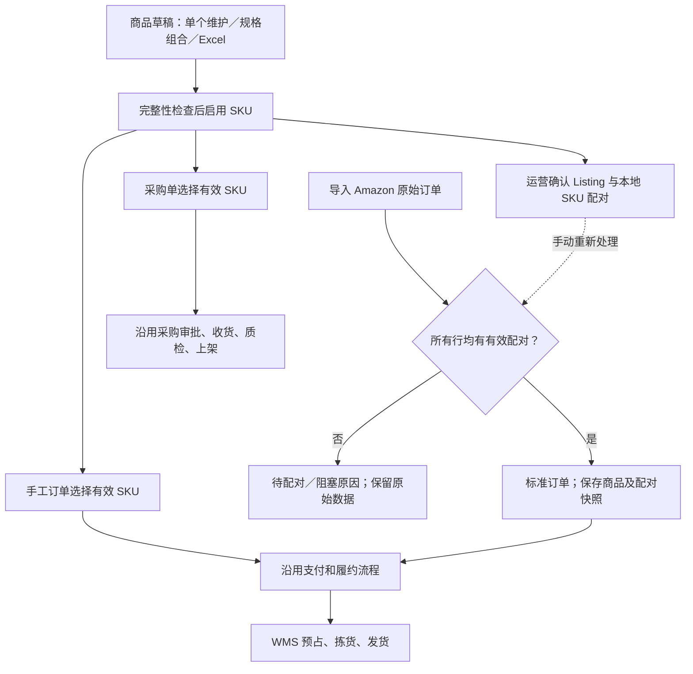

# 商品主数据与 Amazon 商品配对首期规格

Status: ready-for-agent

确认日期：2026-11-21。本文依据已确认的 42 项选择；交付包含 HTTP API 和网页，不包含真实亚马逊接口接入。

## Problem Statement｜问题陈述

商品维护人员目前不能通过网页完整维护可供采购、订单和仓储使用的 SKU。SPU、SKU 与产品变体已有部分实现，但生命周期、规格唯一性、编辑边界和导入规则没有形成一致的业务约束。采购及订单还可能直接接受自由填写的商品编码，无法保证选择的是本租户可用于新增业务的商品。

销售运营已有 Listing 和渠道 SKU 映射基础，但网页没有形成完整的商品配对入口，平台订单解析也没有统一消费配对关系。运营人员需要明确区分本地 SKU 与平台 MSKU；没有配对时必须能保留原始订单，配对后再主动处理，而不能让未知商品进入备货或仓储。配对改动也不能悄悄改变历史订单。

## Solution｜解决方案

建立以本地 SKU 为库存身份的商品维护闭环：创建草稿、完善资料、启用、采购或销售使用、停用、保留历史。提供独立「SKU 管理」入口，同时允许从 SPU 详情维护 SKU；普通商品可以一步创建 SPU 和 SKU，多规格商品使用共享规格字典并按组合生成草稿。

在「销售运营 → Listing 管理」统一展示 Amazon 的店铺、站点、MSKU、ASIN、FNSKU 与本地 SKU 配对结果。运营人员可以人工配对、解除、改配，也可以通过 Excel 按 MSKU 或 ASIN 批量建立及覆盖当前关系。相同编码只推荐候选，仍由人确认。未配对的平台订单进入待配对队列，配对完成后手动重新处理；已经形成的标准订单保留当时的商品和配对快照。

### 主流程

## User Stories｜用户故事

### 商品维护

1. 作为商品维护人员，我希望在独立 SKU 列表跨 SPU 查找商品，以便日常采购和运营问题可以直接定位到库存单位。
2. 作为商品维护人员，我希望从 SPU 详情维护其 SKU，以便集中管理同类商品的不同规格。
3. 作为商品维护人员，我希望普通商品可以一步创建 SPU 与 SKU，以便无需为单规格商品重复录入。
4. 作为商品维护人员，我希望手输或一键生成本地 SKU 编码，以便兼顾既有编码规则与新商品建档效率。
5. 作为商品维护人员，我希望本地编码统一去除首尾空白并转为大写，以便不同写法不会创建重复库存身份。
6. 作为商品维护人员，我希望先保存资料不完整的草稿，以便稍后继续补齐商品信息。
7. 作为商品维护人员，我希望通过独立「保存并启用」操作检查完整性，以便资料满足基础要求后即可使用，无需额外审批。
8. 作为商品维护人员，我希望批量启用或停用选中的 SKU，并看到明确结果，以便高效维护商品生命周期。
9. 作为商品维护人员，我希望停用后仍可查询商品和历史业务，以便停止新增需求时不破坏追溯。
10. 作为商品维护人员，我希望只有从未启用且没有业务引用的草稿可以删除，以便误建记录可清理而历史身份不会消失。
11. 作为商品维护人员，我希望编码、所属 SPU 和规格在启用或被引用后永久锁定，以便单据与库存始终指向同一商品。
12. 作为商品维护人员，我希望分类和品牌由 SPU 统一维护、SKU 继承，以便同组商品的共用资料一致。
13. 作为商品维护人员，我希望在中央维护规格属性和值，并为 SPU 选择允许的组合，以便颜色、尺寸等信息可以规范检索。
14. 作为商品维护人员，我希望同一 SPU 内不能创建重复规格组合，以便不会出现两个编码代表同一变体的误建情况。
15. 作为商品维护人员，我希望预览规格笛卡尔积后勾选批量生成草稿，并看到已有组合的状态，以便只创建需要的 SKU。
16. 作为商品维护人员，我希望每个 SKU 使用固定基本库存单位和整数数量，以便采购、库存和订单数量口径一致。
17. 作为商品维护人员，我希望维护图片、外部条码、重量尺寸、装箱资料、申报资料和备注，以便后续业务取得所需资料。
18. 作为商品维护人员，我希望网页既能上传图片又能填图片链接，以便按实际素材来源建档。
19. 作为采购和物流人员，我希望按实际使用阶段检查资料，以便不把全部物流、申报字段提前变成启用的必填项。

### 商品 Excel 导入

20. 作为商品维护人员，我希望使用同一模板按本地 SKU 编码新增或更新商品，以便集中维护资料。
21. 作为商品维护人员，我希望提交前看到每行新增、更新、保持和清空的内容及错误，以便确认最终变动。
22. 作为商品维护人员，我希望更新行的空白单元格保留原值，可选字段通过明确标记清空，以便避免误删资料。
23. 作为商品维护人员，我希望未知分类、品牌、规格和值在预校验时报错，以便先维护字典而不产生脏数据。
24. 作为商品维护人员，我希望同一文件能创建资料完整的新 SPU 及其 SKU，以便一次导入一组新商品。
25. 作为商品维护人员，我希望 SKU 导入不修改既有 SPU 共用字段，以便局部维护不误改整个商品组。
26. 作为商品维护人员，我希望新导入 SKU 为草稿，更新行保留既有状态，以便启停仍通过明确操作进行。
27. 作为商品维护人员，我希望一行失败时整批不生效，以便不存在需要人工补救的半成品导入。

### 采购与销售使用

28. 作为采购员，我希望在采购单搜索并选择已启用 SKU，以便不再依靠自由填写编码建立采购需求。
29. 作为订单人员，我希望手工订单只选择已启用本地 SKU，以便销售需求能对应正式商品。
30. 作为业务人员，我希望网页与接口都校验商品状态、租户和使用条件，以便直接调用接口也不能绕过规则。
31. 作为采购和仓库人员，我希望已审批采购单在商品停用后仍可按原范围收货及处理退供补货，以便已承诺的采购可以完成。
32. 作为订单和仓库人员，我希望已支付、已预占或已下发仓储的存量订单在商品停用后可以按原范围继续履约，以便停用不会中断既有实物作业。
33. 作为业务人员，我希望未生效草稿在提交、审批、支付等生效关口重新检查 SKU，以便停用商品不能通过旧草稿增加需求。
34. 作为业务人员，我希望历史单据保留当时的商品资料，以便之后修改名称、重量或包装信息不会改写历史。
35. 作为业务人员，我希望未生效草稿可以明确执行「重新带入商品资料」并预览差异，以便需要时采用最新资料。

### Listing 与商品配对

36. 作为运营人员，我希望在统一 Listing 入口按店铺、站点、MSKU、ASIN、本地 SKU 和配对状态查询，以便迅速定位待处理商品。
37. 作为运营人员，我希望可维护或补录现有 Amazon Listing 的平台标识，以便没有平台同步时也能完成配对学习及日常准备。
38. 作为运营人员，我希望 MSKU 按平台原值保存，以便本地编码的大小写规范不会破坏平台标识。
39. 作为运营人员，我希望同一店铺和站点的一个 MSKU 最多存在一个当前有效配对，而本地 SKU 可以被多个 MSKU 配对，以便平台商品与本地库存关系清楚。
40. 作为运营人员，我希望候选推荐仍由我确认，以便相同编码不会被系统误判为同一商品。
41. 作为运营人员，我希望单个或批量配对、解除配对和改配，并查看操作记录，以便关系调整可追溯。
42. 作为运营人员，我希望仅拥有商品配对权限就可以完成配对，而没有修改商品主数据的权限，以便岗位职责独立。
43. 作为运营人员，我希望按 MSKU 导入配对并预览旧本地 SKU 到新本地 SKU 的变化，以便受控覆盖当前关系。
44. 作为运营人员，我希望按 ASIN 导入时先展开指定店铺和站点下系统已存在的 MSKU，以便确认影响范围后批量配对。
45. 作为运营人员，我希望映射文件有任一错误时整批不生效，并在提交时重新校验，以便不会出现跨店铺误配或并发覆盖。
46. 作为运营人员，我希望 ASIN 和 FNSKU 可以后补，以便首次配对只需店铺、站点、MSKU 和已启用本地 SKU。

### 订单解析与更正

47. 作为订单人员，我希望导入的平台订单先保留原始数据，再按渠道标识查配对，以便 MSKU 不会被直接当成本地 SKU。
48. 作为订单人员，我希望任一行未配对时整单进入待配对队列，不预占、不生成采购需求、不下发仓储，以便缺资料的订单不会进入实物流程。
49. 作为订单人员，我希望配对完成后手动单个或批量重新处理，以便主动控制订单进入标准流程的时点。
50. 作为订单人员，我希望重复处理同一原始订单最多得到一张标准订单，以便重试不产生重复业务。
51. 作为订单人员，我希望重新处理只生成标准订单，不自动支付或发货，以便保留原有的业务关口。
52. 作为订单人员，我希望标准订单保留解析时的配对快照，以便后续解除或改配不会改变已有订单。
53. 作为有订单更正权限的人员，我希望在未付款、无财务记录、无预占或旧履约计划、无仓储作业且无实发时填写原因更正 SKU，以便早期错误能受控修复。
54. 作为订单和仓库人员，我希望有资金或实物影响的订单拒绝直接更换 SKU，以便不通过简单改行绕过原业务记录。
55. 作为管理员，我希望当前测试数据可以按正式模型迁移、纠正并形成可重复的演示数据，以便验证真实流程而不用保留错误仿真状态。

## Implementation Decisions｜实现决策

### 1. 模块边界与现有基础

- 保持模块化单体架构。PDM 负责 SPU、SKU、规格及商品资料；SOM 负责 Listing、渠道配对及关系变更记录；OMS 负责原始订单、解析、标准订单快照和允许范围内的更正；SCM 负责采购使用规则；WMS 继续作为库存唯一过账方。
- 跨域通过公共契约及应用服务协作，不直接读取其他领域的内部 Store。商品维护、配对或订单解析本身不增加库存。沿用现有事务及事件策略，不增加微服务、Seata 或新消息基础设施。
- 现有 Sku 与 ProductVariant 存在独立资料和状态入口。以 Sku 为唯一库存身份，整合规格能力和既有变体数据；不得通过旧变体激活接口绕过 SKU 生命周期。优先扩展兼容，不为统一名称立即重命名所有领域中的 sellerSku。
- 现有 ChannelSku 已有租户、渠道、店铺、站点和渠道编码范围，但缺少完整改配、历史及订单消费闭环；在此基础上完善，不另建不被订单使用的第三套配对表。
- 当前工作区已有 SPU/SKU 查询及 Listing 共用组件等改动。实施时以实际代码为基线，保留并补齐；不把旧调研中的页面错误一概当成仍未修复。

### 2. 商品身份、生命周期与权限

| 项目 | 已确认规则 |
| --- | --- |
| 商品类型 | 普通实物与多规格独立库存 SKU；预先打包且按整体管理库存的实物套装可作为普通 SKU |
| 状态 | DRAFT → ACTIVE ⇄ INACTIVE；不引入独立审核状态作为使用前置 |
| 保存 | 默认保存草稿；单独提供「保存并启用」，列表支持批量启停 |
| 启用必填 | 本地编码、名称、所属 SPU、分类、基本库存单位；分类从 SPU 取得 |
| 可选资料 | 品牌、图片、外部条码、物流及申报资料不作为基础启用前提 |
| 本地编码 | 去首尾空白、转大写，仅字母、数字、连字符和下划线；租户内唯一；手输或生成 |
| 身份锁 | 编码、所属 SPU 和规格组合只在草稿且无业务引用时可改；首次启用或引用后永久锁定 |
| 基本单位 | 每 SKU 一个固定基本库存单位，库存数量为整数；身份锁定后不能直接改变单位口径 |
| 删除 | 仅从未启用、无业务引用的草稿可以删除；停用不解除锁定或恢复删除资格 |
| 商品维护权限 | 同一权限覆盖新增、编辑、启停及相关商品字典维护；无需另设启用审批权限 |
| 商品配对权限 | 与商品维护独立，允许配对、解除及改配；不能据此编辑或启停 SKU |

草稿允许资料不完整，稳定内部标识与归属仍应可追踪；不能沿用当前将重量、申报金额提前设为创建必填的约束。各状态转换、锁定、删除资格均在后端强制校验，并保留操作者、时间及必要原因。批量操作显示明确结果，不能把失败项报为成功。SPU 的现有发布状态和 Listing 的上架状态不代表本地 SKU 已启用；SPU 发布不得批量隐式启用子 SKU。

业务引用判定覆盖采购、订单、库存批次/流水、收发货、退货、FBA 等既有来源，包括未关闭或旧版本数据的引用，不能仅查询当前库存余额。对历史曾启用的事实应可靠保存，不能仅凭当前状态倒推。字典值或 SPU 资料变动不能间接改变已锁定 SKU 的规格身份。

### 3. SPU、规格与必要属性

- SPU 保存共用名称、分类和品牌，SKU 继承分类与品牌。普通商品不强制录入规格；多规格使用共享属性/值字典，SPU 选择自己的规格维度和值范围。
- 同一 SPU 的规格组合按稳定属性和值身份判重，与输入顺序、显示文案顺序无关。已有组合无论草稿、启用还是停用都不可重复创建。字典被引用后不能删除或改造成另一种含义；描述性更名不改变身份。
- 批量生成先预览笛卡尔积，标明已有组合及状态，只将勾选且尚不存在的组合保存为草稿。提交时再次校验并发创建及编码冲突，不重复生成。
- 首期资料覆盖图片、外部条码、规格、单位、重量、商品及包装尺寸、装箱数量/箱规、申报资料和备注。明确各数值的单位；重量、尺寸及金额可以为小数，库存件数为整数。箱规仅为资料，不自动将箱数换算为库存数量。
- 网页复用已有文件存储能力支持上传及 URL，上传图片保存稳定对象引用并在查看时取得可用地址，不能把短期签名 URL 当永久图片地址。限制图片类型、大小并按租户鉴权。Excel 仅接收图片 URL，不引入服务端任意地址抓取或 ZIP 对图。
- 重量、尺寸、申报字段在真正需要它们的已有业务动作处检查，并说明缺哪个 SKU 的哪项资料；仅维护或启用商品不强制补齐全部字段。不新增本期范围外的物流/报关流程。

### 4. SKU Excel：统一新增/更新

1. 下载统一模板，按规范化本地编码判断新增或更新。文件内重复编码、大小写归一后冲突、未知字典、无权限对象或锁定字段变更均显示行号、字段和原因。
2. 空白更新单元格保留现值。模板采用明确保留字 `#CLEAR` 清空允许清空的可选字段，预览明确显示「清空」；不允许清空必填项、身份锁定字段或既有 SPU 共用字段。该保留字不能同时作为普通字段值。
3. 新 SKU 默认草稿；更新 SKU 保留状态，不通过文件启停。模板不接受状态变更，若提供非空状态指令应提示使用独立启停操作。
4. 允许同一文件创建新 SPU 和其下 SKU：提供完整 SPU 编码、名称和分类，按明确的 SPU 编码归组，同组共用资料必须一致。品牌可空，但非空必须已存在。不会按相似名称猜测归属。
5. 既有 SPU 的名称、分类、品牌不通过 SKU 文件修改；留空继承现值，非空不一致或试图清空则报错。应在 SPU 自身维护入口修改。
6. 预校验不落业务数据，预览展示全部行的最终变动。确认时绑定本次文件、预览和操作者，再校验权限、字典、锁、唯一性及数据版本；资料已变化时要求重新预览，不能静默覆盖。
7. 整个文件中的 SPU、SKU、规格等业务变更同一事务提交，任何一行或提交阶段失败全部回滚。复用 Excel 读取能力时不能边读批次边提交业务数据。同一次确认重试不能重复创建商品。

### 5. 新业务准入与停用后的履约

| 业务状态/动作 | SKU 停用后的行为 |
| --- | --- |
| 新采购、手工订单、新平台订单解析、新配对 | 不可使用；后端拒绝，网页默认只给有效候选 |
| 未审批采购单 | 在保存新增/改增需求及提交、审批时重新检查；不得借旧草稿使用停用 SKU |
| 已审批采购单 | 原已审批范围可继续收货、质检、上架、退供及合法补货；新增或增加采购需求须重新检查 |
| 未支付、未预占、未下发的订单 | 在新增/改增、支付、生成采购需求、预占及下发等关口检查，不因存在旧订单而自动豁免 |
| 已支付，或已有预占/仓储作业的订单 | 只在原已生效商品与数量范围内继续既有履约，不用停用阻断已开始的实物作业 |
| 历史查询、原单退货、质量追溯 | 继续按原身份和原关联处理；不能转成新增销售/采购需求绕过停用 |

停用不删除现有配对及历史关系，但该关系不能为新订单提供可用的商品解析结果。订单存在任一未配对或目标停用行时，整单留在原始订单处理队列，并区分阻塞原因。

采购和订单的候选查询、提交与生效校验使用一致的本租户有效 SKU 契约；不能仅用下拉框过滤。关键写操作应在事务边界复查，避免候选选择后状态已变化仍建立新需求。不能按「订单未付款」一个标志决定是否可更换商品：现有旧履约计划可能已经产生预占。

### 6. 商品快照与草稿刷新

- 采购和订单在建行或正式解析时保留本地身份、当时名称、规格、单位及该单据使用的重量/包装/申报等资料。后续主数据编辑不自动覆盖已存快照。
- 未生效草稿可主动「重新带入商品资料」，先比较当前快照与主数据，再确认刷新商品资料字段；不改变行数量、单价、税费等用户业务输入，不隐式改变 SKU 或配对。
- 已审批采购、已支付或已有资金/预占/履约计划/仓储/实发影响的订单拒绝该草稿刷新操作。标准订单改 SKU 使用下文的更正用例，不能通过刷新绕过。
- 物流单实际称重、实测包装等属于单据实测值，不能被主数据刷新覆盖。旧数据没有历史快照时不得假装当前值就是当时事实，应标识来源或缺失。

### 7. Amazon Listing 与当前配对

- 统一业务入口为「销售运营 → Listing 管理」。旧「产品开发 → Listing」入口跳转至该入口并保留有效查询条件；已有共用页面实现予以复用，权限按当前用户计算。
- 以租户 + 渠道 Amazon + 店铺 + 站点 + MSKU 标识待配对的渠道商品。现有 Listing 的 SPU 关联和平台刊登编号不能直接等同于可用于订单解析的 SKU 配对；需补齐可明确识别可售 MSKU 的资料。
- MSKU 保存平台原值且按该标识精确匹配，不套用本地编码大写规则。ASIN、FNSKU 是平台资料，可缺省、后补或按现有导入资料维护；FNSKU 不作为本地 SKU 的统一编码。
- 一个范围内的 MSKU 最多一个当前有效本地 SKU 目标，本地 SKU 可对应多个店铺/站点/MSKU。必须明确店铺和站点，不把空范围解释为全部店铺。
- 同码仅作候选提示；人工单个/批量确认后才建立配对。支持解除、重新配对及将原目标换成另一个已启用本地 SKU；展示旧值、新值、影响范围，并记录操作者、时间、来源和原因。
- 配对、解除和改配均保留历史。新标准订单保存解析时的范围、MSKU、目标本地 SKU、配对身份/版本和解析时间，历史不依赖当前有效表反查。
- 配对只决定后续新解析采用的目标，不隐式更新已有标准订单，不触发亚马逊刊登、支付、采购、库存或发货。Listing 在售状态与本地 SKU 启用状态、配对状态分别展示。

### 8. 配对 Excel：按 MSKU 或 ASIN

- 两种模式均先选明确店铺与站点，可在权限内显式多选范围。按 MSKU 模式用范围及精确 MSKU 定位；按 ASIN 模式只展开所选范围内系统已存在的 Listing/MSKU，不调用平台拉取、不凭空创建远端刊登。
- 按 ASIN 展开的多个 MSKU 配到该行指定的同一个本地 SKU。预览必须列出展开后的每个范围及 MSKU，不能只显示 ASIN 汇总。无匹配 Listing、缺失范围或不可唯一解析的资料应报错。
- 导入允许新增以及覆盖已有当前配对，这是第 37 项采纳的领星策略。必须展示「旧目标 → 新目标」，由有商品配对及相应店铺权限的人明确确认。
- 同一最终范围/MSKU 在文件内重复或被不同 ASIN 行展开成冲突目标时拒绝，不能以后行覆盖前行。目标必须是本租户已启用 SKU；跨店铺、跨租户对象拒绝。
- 全量预校验，任何一行失败不变更任何关系。确认时重新检查展开范围、权限、目标状态及当前关系版本，变化后重新预览；不能在预览外偷偷增加覆盖范围。
- 整批业务关系和历史记录原子生效；相同确认重试无重复记录或重复改配。覆盖只影响当前关系，已解析订单快照保持不变。

### 9. 原始订单待配对与手动重处理

- 区分手工本地 SKU 订单与平台 MSKU 订单输入，不根据编码是否存在猜测模式。平台导入先保存原始订单，按明确范围的当前有效配对解析所有行。
- 任一行缺配对或配对目标不可用于新订单时，整单记录待配对/不可用原因，不生成半张标准订单；也不预占、不生成采购需求、不下发仓储或引入财务记录。
- 原始订单队列显示店铺、站点、平台订单号、逐行 MSKU、原因及配对跳转。配对完成仅提示可重处理，不自动重放。
- 支持人工单个及批量重处理。单张订单解析原子化，批量列表逐单返回成功、仍阻塞、已处理或失败的明确结果，不要求整个队列一笔事务。
- 在租户、渠道、店铺、站点及平台订单号范围内保证重复导入/并发重试不重复建标准订单。重复处理已成功原始订单返回原标准订单引用；保留原始接收及处理记录，不把安全重试变成第二张订单。
- 建单只推进到现有标准订单初始/风险审核状态，不自动标为已支付、预占或发货。完成解析后保存行级商品和配对快照，再按原流程处理。

### 10. 标准订单早期 SKU 更正

更正必须同时满足：未付款、无相关财务记录、无任何预占、无旧履约计划、无 WMS 作业、无实际发货。需要核对实际关联记录，不能仅检查订单主状态或把仓库作业存在接口当成完整预占证明。

有相应订单更正权限且有店铺数据权限的人员选择已启用目标 SKU，填写原因并预览影响后提交。保存原目标、新目标、原快照、修正快照、操作者、时间和原因，重新校验商品、风险与该订单已有的成本估算结果，不改动原始平台 MSKU 负载，也不自动修改全局配对关系。接口在同一业务边界重新检查前置条件；任一检查失败不留下部分更正或额外资金、库存动作。

已付款、已预占、已有计划/仓储或已发货的商品更换需要独立回滚、补偿或售后方案，本期不实现。仓储的质量撤拣、退检流程不等同于一般订单 SKU 更正，不能借用它跳过业务回滚。

### 11. 数据、兼容与页面契约

- 用户确认现有业务数据全部为测试数据，允许按本规格纠正状态、补齐主数据、归并变体/渠道身份及迁移引用；无需维持错误仿真状态作为正式规则。
- 实施涉及数据写入前先核对当前基线与备份，给出迁移范围、冲突清单及恢复方式；只处理本功能相关数据，不清空全库或覆盖其他工作区改动。
- 编码归一、变体归并、Listing/MSKU 拆分、单位及状态补齐都需先检测冲突。不能凭当前字符串相同推定跨店铺 MSKU 或历史采购身份相同；缺少证据的数据明确列为待修复。
- 新增约束与兼容迁移同时交付，重复运行不重复造数。关联订单、采购单和 WMS 批次及流水保持可追溯；已有仓储首期流程不得产生第二套库存过账入口。
- 新页面与现有涉及页面按真实 HTTP 数据结构使用稳定 ID、数组或分页响应，完善加载、空数据、失败和越权反馈；不使用假数据或一律将非数组转为空数组来掩盖契约错误。

## Testing Decisions｜测试决策

主要自动验收接缝沿用 erp-app 的 HTTP API 集成测试，从认证请求验证真实的持久化与跨域结果。网页操作同时纳入验收，覆盖创建/编辑/启停、规格生成、两类商品导入、两类配对导入、采购/订单选品、待配对重处理与更正；不以「接口通过」替代网页交付。

- 优先参考已有 PdmApiTests、OmsApiTests、ScmApiTests、PurchaseReceiptApiTests、SalesPickingApiTests 等 API 验证方式；使用正式权限上下文，不以不受约束的伪造请求头代替授权验证。
- ChannelSkuMappingServiceTest 和订单导入审计测试可作为已有行为参考，但原先「已有有效配对一律冲突」的断言需按本期受控改配规则调整；纯算法单测仅补充难以从 API 清楚定位的边界。
- 测试观察状态、查询结果、审计、标准订单、预占和库存结果；不断言私有方法、对象调用次数或内部表的偶然布局。关键事务失败、并发唯一性和重试需验证没有部分业务结果。
- 每张任务同时包含 API 与网页验收，迁移按实际生产数据库类型验证，不能只在内存 Store 中验证唯一性、版本或回滚。

| 验收场景 | 必须观察到的结果 |
| --- | --- |
| 输入 ` mug-01 `，再输入 `MUG-01` | 规范化后同一租户内冲突；其他租户仍相互隔离；平台 MSKU 不被转换 |
| 草稿缺物流资料；补齐五项基础资料后启用 | 草稿可保存，基础启用可成功，真正需要物流资料的动作给出具体缺项 |
| 启用后停用，再改编码/规格/SPU 或删除 | 均拒绝；允许按规则修改描述性资料，不重写历史 |
| 颜色两值、尺寸两值，已有一个组合 | 显示四个组合及已有状态，勾选后仅生成不存在的草稿；重复提交不重造 |
| SKU 文件一行正确、一行未知分类 | 全部不落库；修正后整批提交；更新空白保留，`#CLEAR` 只清空可选字段 |
| 同一文件新建一个 SPU 及两个 SKU | 一个共用 SPU、两个草稿 SKU；任一行失败无部分 SPU 或 SKU |
| 活跃 SKU 建立已审批采购及未审批草稿后停用 | 已审批原范围可继续收货；草稿不能审批为新需求；在手只由 WMS 收货等实际动作变动 |
| 停用前后的新单与存量已生效订单 | 新需求拒绝，原已支付/预占/下发范围继续；不能在老单追加停用商品需求 |
| 主数据改名、改重量/包装，刷新未生效草稿 | 历史单据不变；预览确认只刷新允许的资料；实际称重与业务价格不受覆盖 |
| 同 MSKU 分属不同店铺或站点 | 查询、配对及订单解析分别隔离；同码推荐不自动生效 |
| MSKU 导入由 SKU-A 覆盖为 SKU-B | 先显示旧→新，确认后新订单采用 B，既有标准订单仍是 A；一行失败整批不变 |
| 同 ASIN 在所选范围内已有两个 MSKU | 逐个展开并确认后映射；未选店铺、站点不变；无需调用亚马逊 |
| 两行原始订单中一行未配对 | 保留整单原始信息，队列显示阻塞；无标准半单、资金、需求、预占和 WMS 作业 |
| 配对后手动重处理，并发或重复重试 | 最多一张标准订单，保留解析快照，未自动支付或发货；仍不满足的行继续阻塞 |
| 未付款但已有旧履约计划，或已有部分实发 | 更正被拒绝，即使主状态看起来较早；真正无副作用订单才能带原因更正 |
| 仅有商品配对权限、跨租户/越权店铺请求 | 可在授权范围配对，不可改商品主数据；越权无资料泄露及业务变动 |

## Out of Scope｜不在本期范围

- 亚马逊 OAuth 授权、SP-API 实时拉取、自动同步订单/Listing/库存、自动刊登及远端关系回写。
- 虚拟组合、BOM 拆解、多单位自动换算、库存小数数量、保质期及序列号库存控制。
- 商品独立审批流、导入直接启停、自动同码配对、配对完成自动重放/支付/发货。
- 已付款、预占、已建履约计划、已下发或发货订单的 SKU 更换补偿流程。
- ZIP 图片匹配、按图片文件名对图、服务端抓取任意外链图片。
- 其他渠道完整配对业务、无关财务/报表功能修复、PDA 设备接入与实机验收。

## Further Notes｜补充说明

- 实施任务与 42 项选择对照见本需求目录的任务索引；所有任务初始标记 ready-for-agent，存在前置依赖的任务须等前置完成再领取。
- 第 37 项用户明确采纳领星「Excel 导入可覆盖原配对」策略；本项目同时保留已经确认的明确范围、覆盖预览、权限、原子提交和历史订单快照约束。依据：[领星 Listing 与商品配对帮助](https://www.lingxing.com/help/article/listing1)。其中按 MSKU/ASIN 导入不意味着本项目本期具备真实平台同步。
- 执行验收沿用已确认的 HTTP API + 网页方式；不要求为本期准备真实 PDA。现有仓储任务及其待完成设备范围保持原记录。
- 本规格和任务的 ready-for-agent 表示需求可实施，不表示功能已完成或已经部署。
